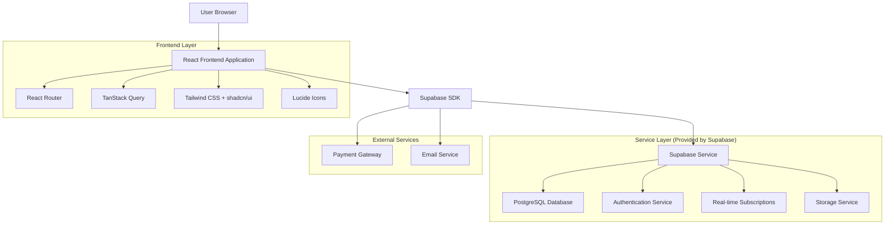
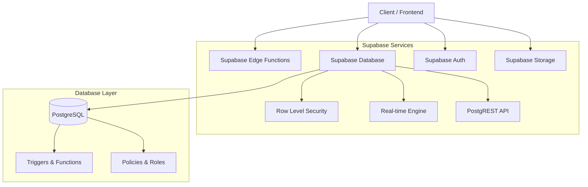
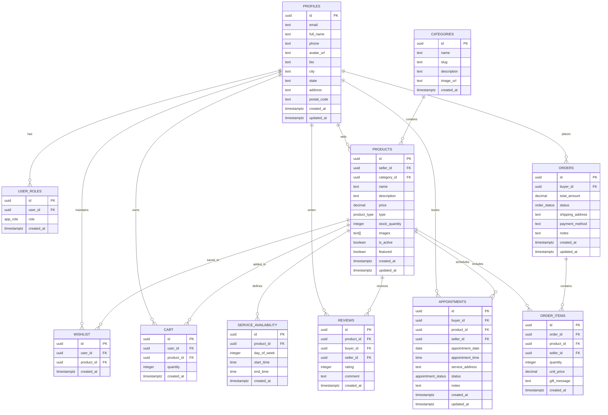

# Documento de Arquitetura Técnica - THEADORO Gift Marketplace

## 1. Architecture design



## 2. Technology Description

- **Frontend**: React@18 + TypeScript + Vite + Tailwind CSS + shadcn/ui
- **Backend**: Supabase (PostgreSQL + Auth + Storage + Real-time)
- **State Management**: TanStack Query para cache e sincronização
- **Routing**: React Router DOM@6
- **UI Components**: shadcn/ui + Radix UI primitives
- **Icons**: Lucide React
- **Forms**: React Hook Form + Zod validation
- **Styling**: Tailwind CSS + CSS Variables

## 3. Route definitions

| Route | Purpose |
|-------|---------|
| / | Página inicial com hero, categorias e produtos em destaque |
| /auth | Página de login e registro de usuários |
| /products | Catálogo de produtos com filtros e busca |
| /products/:id | Detalhes do produto com galeria e avaliações |
| /cart | Carrinho de compras com gestão de itens |
| /checkout | Finalização de compra com dados de entrega e pagamento |
| /dashboard | Dashboard principal do usuário logado |
| /dashboard/profile | Edição de perfil do usuário |
| /dashboard/orders | Histórico de pedidos do comprador |
| /dashboard/appointments | Agendamentos de serviços do comprador |
| /dashboard/wishlist | Lista de favoritos do comprador |
| /seller/dashboard | Dashboard principal do vendedor |
| /seller/products | Gestão de produtos do vendedor |
| /seller/products/new | Cadastro de novo produto |
| /seller/products/:id | Edição de produto existente |
| /seller/sales | Controle de vendas e pedidos |
| /seller/appointments | Agenda de serviços do vendedor |
| /seller/reports | Relatórios de vendas e performance |
| /admin/dashboard | Painel administrativo principal |
| /admin/users | Gestão de usuários e aprovação de vendedores |
| /admin/products | Moderação e aprovação de produtos |
| /admin/categories | Gestão de categorias |
| /admin/orders | Controle geral de pedidos |
| /admin/reports | Relatórios gerais da plataforma |

## 4. API definitions

### 4.1 Core API

**Autenticação de usuários**
```
POST /auth/v1/signup
```

Request:
| Param Name| Param Type  | isRequired  | Description |
|-----------|-------------|-------------|-------------|
| email     | string      | true        | Email do usuário |
| password  | string      | true        | Senha (mínimo 6 caracteres) |
| full_name | string      | true        | Nome completo do usuário |

Response:
| Param Name| Param Type  | Description |
|-----------|-------------|-------------|
| user      | object      | Dados do usuário criado |
| session   | object      | Sessão de autenticação |

**Gestão de produtos**
```
GET /rest/v1/products
```

Request:
| Param Name| Param Type  | isRequired  | Description |
|-----------|-------------|-------------|-------------|
| category_id | uuid      | false       | Filtro por categoria |
| seller_id | uuid        | false       | Filtro por vendedor |
| is_active | boolean     | false       | Filtro por status ativo |
| limit     | integer     | false       | Limite de resultados |
| offset    | integer     | false       | Offset para paginação |

Response:
| Param Name| Param Type  | Description |
|-----------|-------------|-------------|
| data      | array       | Lista de produtos |
| count     | integer     | Total de registros |

**Criação de pedidos**
```
POST /rest/v1/orders
```

Request:
| Param Name    | Param Type  | isRequired  | Description |
|---------------|-------------|-------------|-------------|
| buyer_id      | uuid        | true        | ID do comprador |
| total_amount  | decimal     | true        | Valor total do pedido |
| shipping_address | string   | true        | Endereço de entrega |
| payment_method | string     | true        | Método de pagamento |
| items         | array       | true        | Itens do pedido |

Response:
| Param Name| Param Type  | Description |
|-----------|-------------|-------------|
| id        | uuid        | ID do pedido criado |
| status    | string      | Status inicial do pedido |

## 5. Server architecture diagram



## 6. Data model

### 6.1 Data model definition



### 6.2 Data Definition Language

**Tabela de Perfis (profiles)**
```sql
-- Criação da tabela
CREATE TABLE public.profiles (
  id UUID PRIMARY KEY REFERENCES auth.users(id) ON DELETE CASCADE,
  email TEXT NOT NULL,
  full_name TEXT,
  phone TEXT,
  avatar_url TEXT,
  bio TEXT,
  city TEXT,
  state TEXT,
  address TEXT,
  postal_code TEXT,
  created_at TIMESTAMPTZ DEFAULT now() NOT NULL,
  updated_at TIMESTAMPTZ DEFAULT now() NOT NULL
);

-- Índices
CREATE INDEX idx_profiles_email ON public.profiles(email);
CREATE INDEX idx_profiles_city ON public.profiles(city);

-- Políticas RLS
CREATE POLICY "Public profiles are viewable by everyone"
  ON public.profiles FOR SELECT
  USING (true);

CREATE POLICY "Users can update own profile"
  ON public.profiles FOR UPDATE
  USING (auth.uid() = id);
```

**Tabela de Produtos (products)**
```sql
-- Criação da tabela
CREATE TABLE public.products (
  id UUID PRIMARY KEY DEFAULT gen_random_uuid(),
  seller_id UUID REFERENCES public.profiles(id) ON DELETE CASCADE NOT NULL,
  category_id UUID REFERENCES public.categories(id) ON DELETE SET NULL,
  name TEXT NOT NULL,
  description TEXT,
  price DECIMAL(10,2) NOT NULL CHECK (price >= 0),
  type public.product_type DEFAULT 'physical' NOT NULL,
  stock_quantity INTEGER DEFAULT 0 CHECK (stock_quantity >= 0),
  images TEXT[] DEFAULT '{}',
  is_active BOOLEAN DEFAULT true,
  featured BOOLEAN DEFAULT false,
  created_at TIMESTAMPTZ DEFAULT now() NOT NULL,
  updated_at TIMESTAMPTZ DEFAULT now() NOT NULL
);

-- Índices
CREATE INDEX idx_products_seller_id ON public.products(seller_id);
CREATE INDEX idx_products_category_id ON public.products(category_id);
CREATE INDEX idx_products_is_active ON public.products(is_active);
CREATE INDEX idx_products_featured ON public.products(featured);
CREATE INDEX idx_products_price ON public.products(price);

-- Políticas RLS
CREATE POLICY "Active products are viewable by everyone"
  ON public.products FOR SELECT
  USING (is_active = true OR seller_id = auth.uid() OR public.has_role(auth.uid(), 'admin'));

CREATE POLICY "Sellers can create products"
  ON public.products FOR INSERT
  TO authenticated
  WITH CHECK (
    auth.uid() = seller_id AND 
    (public.has_role(auth.uid(), 'seller') OR public.has_role(auth.uid(), 'admin'))
  );
```

**Tabela de Pedidos (orders)**
```sql
-- Criação da tabela
CREATE TABLE public.orders (
  id UUID PRIMARY KEY DEFAULT gen_random_uuid(),
  buyer_id UUID REFERENCES public.profiles(id) ON DELETE CASCADE NOT NULL,
  total_amount DECIMAL(10,2) NOT NULL CHECK (total_amount >= 0),
  status public.order_status DEFAULT 'pending' NOT NULL,
  shipping_address TEXT,
  payment_method TEXT,
  notes TEXT,
  created_at TIMESTAMPTZ DEFAULT now() NOT NULL,
  updated_at TIMESTAMPTZ DEFAULT now() NOT NULL
);

-- Índices
CREATE INDEX idx_orders_buyer_id ON public.orders(buyer_id);
CREATE INDEX idx_orders_status ON public.orders(status);
CREATE INDEX idx_orders_created_at ON public.orders(created_at DESC);

-- Dados iniciais
INSERT INTO public.categories (name, slug, description) VALUES
  ('Presentes', 'presentes', 'Presentes especiais para todas as ocasiões'),
  ('Flores', 'flores', 'Flores e arranjos florais'),
  ('Moda', 'moda', 'Roupas e acessórios'),
  ('Beleza e Bem-estar', 'beleza-bem-estar', 'Produtos e serviços de beleza'),
  ('Serviços em Domicílio', 'servicos-domicilio', 'Serviços realizados na sua casa'),
  ('Experiências', 'experiencias', 'Experiências únicas e memoráveis');
```