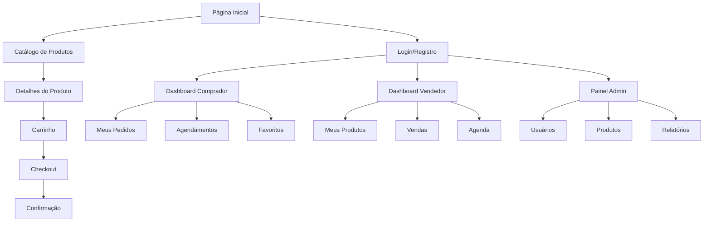

# Documento de Requisitos do Produto - THEADORO Gift Marketplace

## 1. Product Overview

O THEADORO é um marketplace premium de presentes que conecta compradores a vendedores especializados em produtos únicos e serviços personalizados. A plataforma oferece desde produtos físicos até experiências e serviços em domicílio, com foco em ocasiões especiais e presentes memoráveis.

O sistema resolve o problema de encontrar presentes únicos e personalizados, oferecendo uma curadoria de vendedores qualificados e produtos diferenciados. Destinado a pessoas que buscam presentes especiais e vendedores que desejam alcançar um público premium.

O objetivo é se tornar a principal plataforma de presentes premium no mercado brasileiro, oferecendo experiência de compra excepcional e oportunidades de negócio para vendedores especializados.

## 2. Core Features

### 2.1 User Roles

| Role | Registration Method | Core Permissions |
|------|---------------------|------------------|
| Comprador (Buyer) | Registro por email | Pode navegar, comprar produtos, agendar serviços, avaliar vendedores |
| Vendedor (Seller) | Aprovação por admin | Pode cadastrar produtos/serviços, gerenciar vendas, atender agendamentos |
| Administrador (Admin) | Acesso interno | Controle total da plataforma, aprovação de vendedores, moderação |

### 2.2 Feature Module

Nosso marketplace consiste nas seguintes páginas principais:

1. **Página Inicial**: hero section, navegação principal, categorias em destaque, produtos populares, vendedores em destaque
2. **Catálogo de Produtos**: listagem com filtros, busca, paginação, ordenação por preço/popularidade
3. **Detalhes do Produto**: informações completas, galeria de imagens, avaliações, agendamento (para serviços)
4. **Carrinho de Compras**: itens selecionados, cálculo de frete, aplicação de cupons
5. **Checkout**: dados de entrega, pagamento, confirmação do pedido
6. **Autenticação**: login, registro, recuperação de senha
7. **Dashboard do Comprador**: pedidos, agendamentos, favoritos, perfil
8. **Dashboard do Vendedor**: produtos, vendas, agendamentos, relatórios
9. **Painel Administrativo**: usuários, produtos, categorias, pedidos, relatórios

### 2.3 Page Details

| Page Name | Module Name | Feature description |
|-----------|-------------|---------------------|
| Página Inicial | Hero Section | Exibe banner principal com call-to-action, navegação para categorias principais |
| Página Inicial | Categorias em Destaque | Grid de categorias com imagens e links diretos para catálogo filtrado |
| Página Inicial | Produtos Populares | Carrossel de produtos mais vendidos com preços e avaliações |
| Página Inicial | Vendedores em Destaque | Seção destacando vendedores premium com suas especialidades |
| Catálogo | Listagem de Produtos | Grid responsivo com imagens, preços, avaliações e filtros laterais |
| Catálogo | Sistema de Filtros | Filtros por categoria, preço, localização, tipo (produto/serviço), avaliação |
| Catálogo | Busca e Ordenação | Campo de busca textual e opções de ordenação por relevância, preço, popularidade |
| Detalhes do Produto | Galeria de Imagens | Visualização de múltiplas imagens com zoom e navegação |
| Detalhes do Produto | Informações do Produto | Descrição detalhada, especificações, política de entrega/agendamento |
| Detalhes do Produto | Sistema de Avaliações | Exibição de avaliações com estrelas, comentários e filtros |
| Detalhes do Produto | Agendamento de Serviços | Calendário para seleção de data/hora para serviços |
| Carrinho | Gestão de Itens | Adicionar, remover, alterar quantidade, salvar para depois |
| Carrinho | Cálculo de Valores | Subtotal, frete, descontos, total final com atualização em tempo real |
| Checkout | Dados de Entrega | Formulário de endereço com validação de CEP e opções de entrega |
| Checkout | Pagamento | Integração com gateway de pagamento, múltiplas formas de pagamento |
| Autenticação | Login/Registro | Formulários com validação, recuperação de senha, verificação de email |
| Dashboard Comprador | Meus Pedidos | Histórico de compras com status, tracking, opção de recompra |
| Dashboard Comprador | Agendamentos | Lista de serviços agendados com status e opções de reagendamento |
| Dashboard Comprador | Lista de Favoritos | Produtos salvos com opção de adicionar ao carrinho |
| Dashboard Vendedor | Gestão de Produtos | CRUD completo de produtos com upload de imagens e categorização |
| Dashboard Vendedor | Controle de Vendas | Pedidos recebidos, status de entrega, comunicação com compradores |
| Dashboard Vendedor | Agenda de Serviços | Calendário de agendamentos com confirmação e gestão de horários |
| Dashboard Vendedor | Relatórios de Vendas | Métricas de performance, gráficos de vendas, produtos mais vendidos |
| Painel Admin | Gestão de Usuários | CRUD de usuários, aprovação de vendedores, controle de permissões |
| Painel Admin | Moderação de Produtos | Aprovação, edição e remoção de produtos, controle de qualidade |
| Painel Admin | Gestão de Categorias | CRUD de categorias com hierarquia e associação de produtos |
| Painel Admin | Controle de Pedidos | Visão geral de todos os pedidos, resolução de disputas |
| Painel Admin | Relatórios Gerais | Dashboard com métricas da plataforma, vendas, usuários ativos |

## 3. Core Process

### Fluxo do Comprador
O comprador acessa a plataforma, navega pelas categorias ou utiliza a busca para encontrar produtos. Visualiza detalhes do produto, adiciona ao carrinho e finaliza a compra no checkout. Para serviços, pode agendar data e horário. Acompanha pedidos e agendamentos no dashboard pessoal.

### Fluxo do Vendedor
O vendedor cadastra produtos em seu dashboard, gerencia estoque e preços. Recebe notificações de novos pedidos, confirma disponibilidade e atualiza status de entrega. Para serviços, gerencia agenda e confirma agendamentos. Acompanha performance através de relatórios.

### Fluxo do Administrador
O administrador monitora a plataforma através do painel de controle, aprova novos vendedores e produtos. Modera conteúdo, resolve disputas entre usuários e analisa métricas de performance. Gerencia categorias e configurações da plataforma.

## 4. User Interface Design

### 4.1 Design Style

- **Cores Primárias**: Wine (#722F37) como cor principal, representando elegância e sofisticação
- **Cores Secundárias**: Tons neutros (cinza, branco) para backgrounds e textos
- **Estilo de Botões**: Bordas arredondadas com efeito hover suave, variações wine e outline
- **Tipografia**: Font serif para títulos (elegância), sans-serif para textos (legibilidade)
- **Layout**: Design card-based com espaçamento generoso, navegação top fixa
- **Ícones**: Lucide React com estilo minimalista, tamanho consistente 16-24px

### 4.2 Page Design Overview

| Page Name | Module Name | UI Elements |
|-----------|-------------|-------------|
| Página Inicial | Hero Section | Background gradient wine/transparente, título serif grande, botão CTA wine |
| Página Inicial | Categorias | Grid 2x3 responsivo, cards com imagem de fundo, overlay escuro, texto branco |
| Catálogo | Filtros Laterais | Sidebar colapsível, checkboxes customizados, range slider para preços |
| Catálogo | Grid de Produtos | Cards com hover effect, imagem quadrada, preço destacado em wine |
| Detalhes | Galeria | Imagem principal grande, thumbnails abaixo, modal de zoom |
| Dashboard | Navegação | Tabs horizontais com ícones, indicadores de estado ativo |
| Dashboard | Cards de Métricas | Background branco, bordas sutis, ícones coloridos, números grandes |
| Formulários | Campos de Input | Bordas arredondadas, focus state wine, labels flutuantes |
| Tabelas | Listagens | Zebra striping, hover rows, ações em dropdown, paginação numerada |

### 4.3 Responsiveness

O produto é mobile-first com adaptação para desktop. Utiliza breakpoints do Tailwind CSS (sm, md, lg, xl). Navegação mobile com menu hambúrguer, cards empilhados em telas pequenas, tabelas com scroll horizontal quando necessário. Touch interactions otimizadas para dispositivos móveis.